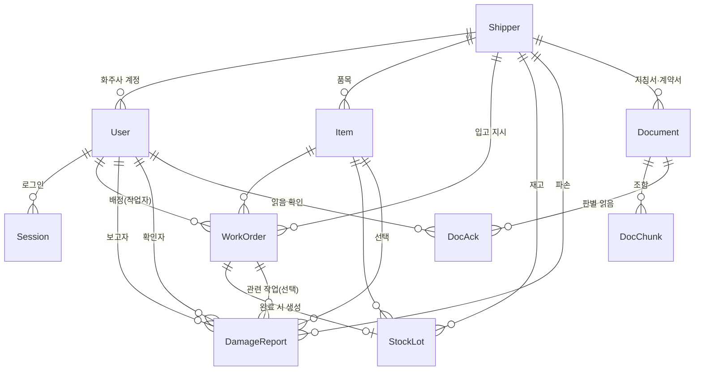

# 기능 명세서 · 한빛 WMS Lite (고객사 13 · 한빛물류 이천센터)

> 11/13 · 실제 구현(GitHub main `af9491c`)과 인터뷰 기록(`docs/인터뷰기록.md`, `docs/인터뷰기록_2차.md`)에 맞춰 갱신함
> 배포: 화면 https://hanbit-wms-web.onrender.com · 처리 서버 https://hanbit-wms-api.onrender.com · 저장소 https://github.com/hyliliana/hanbit-wms-lite

## 0. 한 줄 요약

화주사 18곳의 서로 다른 규칙을 **작업자 휴대폰**과 **관리자 화면**에서 바로 찾고 지키게 하는 창고 업무 앱입니다.

| 오늘 만든 기능 | 고객 요구 | 구현 |
|---|---|---|
| F1 입고 작업지시와 수량 차이 표시 | 요구 1·2 | ✅ |
| F2 파손 즉시 보고(사진·물건 필수, 발견 시각 자동) + 관리자 확인 | 요구 3 · 2차 인터뷰(센터장) 사진·발견 시각·입고 물건 식별은 꼭 필요 | ✅ |
| F3 화주사별 문서 근거 규칙 질문 | 요구 4 | ✅ |
| F4 지침서 새 판 업로드와 바뀐 조항 표시 | 요구 5 | ✅ |
| F5 역할 권한과 화주사 데이터 격리(보관 위치·작업자·센터 메모 비공개) | 요구 6 · 2차 인터뷰(최 과장) | ✅ |
| ★ 가산점: 파손 보고 순간 그 화주사의 파손 처리 지침을 근거와 함께 자동 첨부 | 장면: 최 과장이 지침서를 찾느라 1시간 지연 | ✅ |
| F6 파손 30분 확인 기준: 경과 시간 표시, 30분 넘긴 미확인 건은 요약 경고 + **센터장 화면 맨 위 알림** | 1차(장 씨) "30분 안에는 확인해야 해요" · 2차(관리자 김) "30분 안에 확인하지 못하면 센터장님께 알려야 합니다" | ✅ |
| F7 작업자 개정 알림 + **읽음 확인(판당 1회)**, 관리자는 판별 읽음 현황 확인 | 1차(관리자 김) "작업자도 알아야 합니다" · 2차(관리자 김) 판당 한 번 | ✅ |
| F8 작업지시 카드의 화주사 입고 주의사항(현행 지침서 원문) | 인터뷰(장 씨) "작업 순서나 주의할 점을 헷갈려하는 경우가 있어요" | ✅ |
| F9 자주 찾는 질문 버튼(파손 처리·보관 온도·출고 순서) | 인터뷰(최 과장) 가장 자주 찾는 세 가지 | ✅ |
| F10 지침서·계약서가 다르면 AI가 판단하지 않고 "화주사와 확인이 필요합니다" 표시 | 1차(최 과장) 우선 기준 모름 · 2차: 센터가 자체로 최종 결정할 수 없음 | ✅ |
| ★ F11 화주사 통보 기한(가산점 · 고객이 말하지 않았지만 필요한 기능): 파손 보고 순간 그 화주사 지침서의 기한을 읽어 **통보 마감 시각·남은 시간·근거 조항** 표시, 통보 완료 기록, 기한 넘긴 건 요약 경고 | 인터뷰 Q4(최 과장) "알리는 기한을 따로 정해 둔 곳이 있는지는 바로 확인해 봐야 해요" — 기한을 모름. 그런데 보관계약서 제6조는 지침서 기한 안에 통보하지 않아 늘어난 손해를 센터가 부담하게 함 | ✅ |

> **F11을 제안한 이유:** 고객은 "파손을 빨리 알리고 싶다"고만 했고 통보 기한은 말하지 않았습니다. 하지만 계약서를 읽어 보니 기한을 넘기면 손해를 센터가 떠안습니다(제6조). 관리자는 그 기한을 모르고(Q4), 기한은 화주사마다 다릅니다(신선마켓 2시간, 루미코스메틱 발견 당일, 한겨울푸드 6시간 ← 제2판에서 24시간에서 바뀜). 그래서 기한을 사람이 기억하지 않아도 되게 했습니다. 지침서에 기한이 없으면 센터 기본값을 지어내지 않고 "기한 없음 · 관리자 판단"으로 둡니다.

---

## 1. 사용자(역할)와 데모 계정

| 역할 | 실제 사람 | 데모 아이디 | 기기 | 핵심 목적 |
|---|---|---|---|---|
| ADMIN 센터장 | 센터장 | center | PC | 전체 현황, 30분 초과 파손 알림 받기, 문서 관리 |
| MANAGER 관리자 | 최 과장, 관리자 김 | choi, kim | PC | 입고 등록, 수량 차이·파손 확인, 화주사 통보 기록, 규칙 질문 |
| WORKER 작업자 | 장 씨(냉장), 응우옌(냉동) | jang, nguyen | 휴대폰 | 내 작업 완료, 파손 보고, 개정 읽음 확인, 규칙 질문 |
| SHIPPER 화주사 담당 | 신선마켓·루미코스메틱·한겨울푸드 담당자 | fresh, beauty, frozen | PC/휴대폰 | 자기 회사 재고·입고·파손만 조회 |

로그인 화면에 데모 계정 버튼이 있어 누르면 아이디가 채워집니다. 비밀번호는 발표 때 구두로 안내합니다(문서에 적지 않음).

---

## 2. 화면 목록

화면은 **한 주소(/)** 에서 로그인한 역할에 따라 바뀝니다. 상단에 이름·역할과 로그아웃이 있습니다.

| ID | 화면(탭) | 사용자 | 하는 일 | 입력 | 결과 |
|---|---|---|---|---|---|
| S01 | 로그인 | 전원 | 들어가기 | 아이디, 비밀번호 (데모 계정 버튼) | 역할별 화면. 틀리면 "아이디 또는 비밀번호가 맞지 않습니다" |
| **작업자 (휴대폰)** |||||
| S10 | 내 작업 | WORKER | 나에게 배정됐거나 미배정인 입고 작업을 봄 | – | 맨 위에 **개정 알림**("📢 ○○ 지침서 제N판으로 바뀌었습니다" + 바뀐 내용 요약, 최근 14일)과 **"읽었습니다" 버튼**(누르면 "읽음 확인 시각" 표시, 판당 1회). 작업 카드(화주사, 품목, 예정 수량, 위치). 탭에 대기 건수 |
| S10-1 | 내 작업 › 입고 주의사항 | WORKER | 카드의 "○○ 입고 주의사항 보기"로 펼침 | – | 그 화주사 현행 지침서의 입고·검수·수량·온도·파손 조항 **원문**(문서명·판 표시). 지침서가 없으면 "관리자에게 확인하세요" |
| S11 | 내 작업 › 입고 완료 | WORKER | 실제 받은 수량을 넣고 완료 | 실제 받은 수량 | 완료·재고 생성. 예정≠실제면 차이 표시 |
| S12 | 파손 보고 | WORKER (작업 카드의 "파손 있음"으로도 진입) | 바로 보고 | 화주사, **입고 물건(필수)**, 파손 수량(박스), 설명, **사진(필수, 자동 축소)** | 사진·물건이 없으면 보내기 버튼이 꺼짐. "발견 시각은 보고하는 순간 자동으로 기록됩니다". 보고 저장 → 관리자 파손함 배지. **그 화주사의 파손 처리 방법 + 근거 조항**, **화주사 통보 마감 시각·남은 시간·근거 조항** 즉시 표시(기한이 없으면 "기한 없음 · 관리자 판단") |
| S13 | 규칙 질문 | WORKER | 화주사 규칙을 물어봄 | 화주사, 질문(또는 **자주 찾는 질문** 버튼 3개: 파손 처리·보관 온도·출고 순서) | 답 + 근거(문서명·판·조항·원문). 근거 없으면 답을 만들지 않음. 지침서·계약서가 같은 일에 다른 기준이면 둘을 나란히 보이고 "⚠ 화주사와 확인이 필요합니다" |
| **관리자 (PC)** |||||
| S20 | 요약 | ADMIN, MANAGER | 숫자 카드: 미확인 파손, **30분 넘게 확인 안 된 파손**(1건 이상이면 빨간 테두리), **화주사 통보 기한 지난 파손**, 수량 차이 입고, 대기 중 입고 | – | 30분 초과 건이 있으면 화면 맨 위 빨간 알림 띠(센터장에게는 "🔔 센터장 알림: … 관리자 확인이 늦어지고 있습니다"). 누르면 파손함으로 이동 |
| S21 | 파손함 (배지) | ADMIN, MANAGER | 파손 보고 확인, 화주사 통보 완료 기록 | 처리 메모, "화주사에 통보함" 체크 → "확인 처리" / 확인 뒤 "통보 완료" | 미확인→확인됨, 확인자·시각·메모 기록. 미확인은 "보고 후 N분"(30분 넘으면 빨강), 확인된 건은 "확인까지 N분". **통보 마감 시각·남은 시간·근거 조항**(없으면 "기한 없음 · 관리자 판단"), 통보하면 통보 시각. 사진·설명·AI 첨부 지침과 근거 함께 표시. 10초마다 새로고침 |
| S22 | 입고·수량 차이 (배지) | ADMIN, MANAGER | 입고 예정 등록과 내역 | 화주사, 품목, 예정 수량, 보관 위치, 유통기한 | 작업지시 생성. 내역 표에서 "수량 차이만" 체크로 거르기 |
| S23 | 재고 | ADMIN, MANAGER | 화주사별 재고 로트 | 화주사(선택) | 품목, 구역, 수량, 위치, 로트, 유통기한(임박 순) |
| S24 | 지침서·계약서 | ADMIN, MANAGER | 새 판 올리기, 문서 목록·원문 보기, **작업자 읽음 현황** | 화주사, 종류(취급 지침서/보관 계약서), 파일(.md/.txt) | 새 판이 현행, 예전 판 보관. **"제1판→제2판 · 변경 N · 추가 N · 삭제 N" + AI 요약 + 조항별 전/후**. 목록에 "작업자 읽음 N명", 보기에서 "읽음 확인 N/전체 명 · 작업자별 ✓시각/미확인" |
| S25 | 규칙 질문 | ADMIN, MANAGER | S13과 같음(자주 찾는 질문 버튼 포함) | 화주사, 질문 | 답 + 근거 |
| **화주사** |||||
| S30 | 내 재고 | SHIPPER | 자기 회사 재고 | – | 품목, 구역, 로트, 수량, 입고일, 유통기한 (**보관 위치 없음**) |
| S31 | 입고 내역 | SHIPPER | 예정 대비 실제 | – | 예정·실제·차이·완료 여부와 시각 (보관 위치·작업자·센터 메모 없음) |
| S32 | 파손 보고 (읽기 전용) | SHIPPER | 자기 물건 파손 현황 | – | "센터 확인 중/확인 완료", 파손 내용, 사진, **센터 통보 시각** (센터 메모·확인자·내부 처리 지침·기한 근거 조항은 서버에서 제외) |

---

## 3. 데이터 설계

### 3-1. 테이블 (`prisma/schema.prisma`)

| 테이블 | 뜻 | 주요 칸 | 비고 |
|---|---|---|---|
| Shipper | 화주사 | id, code(고유: FRESH·BEAUTY·FROZEN), name | 시연용 3곳 |
| User | 사용자 | id, loginId(고유), passwordHash(scrypt), name, role, shipperId? | shipperId는 SHIPPER만 |
| Session | 로그인 상태 | token(무작위 48자), userId, expiresAt(12시간) | |
| Item | 품목 | id, shipperId, sku, name, zone(AMBIENT/CHILLED/FROZEN) | (shipperId, sku) 고유 |
| WorkOrder | 입고 작업지시 | id, shipperId, itemId, expectedQty, actualQty?, location, lotNo, expiryDate?, status(PLANNED/DONE), assigneeId?, note?, createdAt, completedAt? | 차이는 계산값 |
| StockLot | 재고 로트 | id, shipperId, itemId, workOrderId?(고유), location, lotNo, qty, receivedAt, expiryDate? | 입고 완료 시 생성(수량 0이면 생성 안 함) |
| DamageReport | 파손 보고 | id, shipperId, itemId?, workOrderId?, reporterId, qty, description, photo(축소 이미지, API에서 필수), status(REPORTED/CONFIRMED), aiGuidance, aiCitations(JSON), managerNote?, confirmedById?, confirmedAt?, **createdAt(= 발견·보고 시각, 서버 자동)**, notifyHours?(지침서 기한, 시간), notifyDueAt?(통보 마감 시각), notifySource?(기한 근거 조항), notifiedAt?(통보 완료 시각), notifiedById?(기록한 관리자) | 품목 또는 작업지시 중 하나는 API에서 필수. 기한·근거는 보고 순간 저장(나중에 지침서가 바뀌어도 그때 기준 유지) |
| Document | 문서(판) | id, shipperId, kind(GUIDE/CONTRACT), title, version, isCurrent, changeSummary(JSON), createdAt | (shipperId, kind, version) 고유 |
| DocChunk | 조항 | id, documentId, order, section("제5조 (파손 입고 시 처리)"), text, embedding(Float[]) | 검색 단위. 문서 삭제 시 함께 삭제 |
| **DocAck** | 개정 읽음 확인 | id, documentId, userId, ackedAt | **(documentId, userId) 고유 → 판당 1회.** 문서·사용자 삭제 시 함께 삭제 |

### 3-2. 관계(ERD)

### 3-3. 저장값과 계산값
- **저장:** 예정 수량, 실제 수량, 문서 조항 원문과 임베딩, 개정 비교 결과(업로드 시점), 파손 보고 시점의 통보 기한, 읽음 확인 시각.
- **계산:** 수량 차이(실제 − 예정, 응답에 `diff`로 포함), 요약 숫자 카드, 판별 읽음 인원. 차이를 따로 저장하지 않아 표시가 어긋날 일이 없습니다.

---

## 4. 규칙과 지키는 곳

| # | 규칙 | 지키는 곳 | 어기면 |
|---|---|---|---|
| R1 | 화주사 계정은 자기 화주사 데이터만 (품목·입고·재고·파손) | **API** `scopeShipper`: 조건을 자기 shipperId로 강제 | 다른 shipperId 요청 시 403 "다른 화주사의 정보는 볼 수 없습니다" |
| R1-1 | 화주사에게 **공개:** 재고, 입고 완료 여부·시각, 수량 차이, 파손 사실·내용·사진, 센터 통보 시각. **비공개:** 보관 위치, 작업자, 센터 메모, 확인자, 내부 처리 지침·근거 조항 | **API**가 응답에서 칸을 뺌(입고: location·assignee·note / 재고: location / 파손: aiGuidance·aiCitations·notifySource·managerNote·confirmedBy·notifiedById) | 화면을 우회해 API를 직접 불러도 안 보임. 근거: 2차 인터뷰(최 과장) 보관 위치 공개 여부 미정 → 보내지 않음 |
| R2 | 실제 수량(0 이상 정수) 없이 입고 완료 불가 | **API** + 화면 입력 | 400 |
| R3 | 이미 완료된 작업은 다시 완료 불가 | **API**(트랜잭션 안에서 확인) | 400 "이미 완료된 작업입니다" |
| R4 | 작업자는 자기에게 배정된 작업(또는 미배정 작업)만 보고 완료 | **API** | 다른 작업자 작업 완료 시 403. 미배정 작업은 완료한 작업자에게 배정됨 |
| R5 | 예정≠실제면 차이 표시 | **API** 계산 → 화면 빨간 행, 요약 카드 | – |
| R6 | 예정 수량은 1 이상 정수, 보관 위치 필수 | **API** | 400 |
| R7 | 파손 보고에는 화주사·설명·**사진(data:image)**·**품목 또는 작업지시** 필수. 품목은 그 화주사 것만. 사진은 1.5MB 이하(화면에서 900px로 자동 축소). **발견 시각은 서버가 자동 기록** | **API** + 화면(버튼 꺼짐) | 400 "파손 사진을 첨부해야 보고할 수 있습니다" / "어떤 입고 물건인지(품목 또는 작업지시) 골라야 합니다" |
| R8 | 파손 확인은 관리자·센터장만, 한 번만 | **API** | 403 / 400 |
| R9 | 규칙 질문은 고른 화주사의 **현행** 문서만 근거 | **API** 검색 조건(shipperId + isCurrent) | 다른 화주사 규칙이 섞이지 않음 |
| R10 | 화주사·종류별 현행 문서는 1개, 예전 판은 보관 | **API 트랜잭션**(예전 판 isCurrent=false와 새 판 저장을 한 번에) + DB 고유키(shipperId, kind, version) | – |
| R11 | 조항 형식(`## 제N조 (조항명)`)이 없는 파일은 거부 | **API** | 400 |
| R12 | 로그인 없이는 /health·로그인·데모 계정 목록 외 접근 불가 | **API** 전역 가드 | 401 |
| R13 | AI 키·DB 주소는 처리 서버 환경변수에만 | 서버 `.env` / Render 환경변수 | 화면 코드·GitHub에 없음 |
| R14 | 파손 보고는 30분 안에 관리자 확인(현장 기준). 넘기면 센터장에게 알림 | **API** 요약에서 30분 넘은 미확인 건수 계산(`DAMAGE_SLA_MIN = 30`) + 화면: 경과 시간 칩, 관리자·센터장 화면 맨 위 알림 띠(센터장용 문구 별도) | 막지는 않고 경고·알림만 |
| R15 | 지침서와 계약서가 **같은 일에 다른 기한·숫자·방법**을 정했으면 AI는 어느 쪽이 맞는지 정하지 않음. 한 문서에만 있거나 서로 보완하면 경고하지 않음 | **API** AI 지시문 | "지침서: …[n]" / "계약서: …[n]"을 나란히 + "⚠ 지침서와 계약서가 다릅니다. 화주사와 확인이 필요합니다(센터가 자체로 최종 결정할 수 없음)" |
| R16 | 계약 내용은 화주사에게 비공개 | **API** 문서·질문·주의사항·개정 알림·읽음 확인은 직원(ADMIN·MANAGER·WORKER)만 | 화주사 계정은 403 |
| R17 | 파손 보고 순간 화주사 통보 기한을 계산 — **AI가 아닌 규칙**: 현행 지침서(GUIDE)에서 조항명에 '파손'이 들어간 조항을 찾아 "N시간 안/이내"를 읽음 → 마감 = 보고 시각 + N시간. "당일 안/이내/중"이면 한국 시간 그날 23:59 | **API** `notifyDeadline` | 기한을 찾지 못하면 마감 없음 → 화면 "화주사 통보 기한 없음 · 관리자 판단"(센터 기본값 없음) |
| R18 | 통보 완료는 관리자·센터장만, 한 번만 기록 | **API** | 403 / 400 "이미 통보 완료로 기록했습니다" |
| R19 | 개정 읽음 확인은 **판당 1회**. 다시 눌러도 첫 시각 유지 | **DB** 고유키(documentId, userId) + **API** upsert | 오류 없이 기존 기록 반환. 근거: 2차 인터뷰(관리자 김) 너무 자주 누르면 번거로움 |

---

## 5. 권한 표

○ 가능 · △ 자기 것만 · × 불가 (모두 처리 서버에서 판단)

| 기능 | ADMIN 센터장 | MANAGER 관리자 | WORKER 작업자 | SHIPPER 화주사 |
|---|---|---|---|---|
| 요약 숫자 | ○ | ○ | × | × |
| 30분 초과 파손 알림 띠 | ○ (센터장 알림) | ○ | × | × |
| 입고 예정 등록 | ○ | ○ | × | × |
| 입고 목록 | ○ | ○ | △ 배정+미배정 | △ 자기 화주사(완료 여부·시각·차이만, 위치·작업자·메모 제외) |
| 입고 완료 | ○ | ○ | △ 배정+미배정 | × |
| 품목 조회 | ○ | ○ | ○ | △ 자기 화주사 |
| 재고 조회 | ○ | ○ | ○ | △ 자기 화주사(보관 위치 제외) |
| 파손 보고 | ○ | ○ | ○ | × |
| 파손 목록 | ○ | ○ | △ 내가 보고한 것 | △ 자기 화주사(파손 사실·내용·사진·통보 시각만) |
| 파손 확인 | ○ | ○ | × | × |
| 화주사 통보 완료 기록 | ○ | ○ | × | × |
| 통보 마감·근거 조항 보기 | ○ | ○ | ○ (내 보고) | △ 통보 시각만(근거 조항 제외) |
| 문서 목록·원문 | ○ | ○ | ○ | × (계약 내용 비공개) |
| 문서 업로드(새 판) | ○ | ○ | × | × |
| 개정 알림(최근 14일) | ○ | ○ | ○ | × |
| 개정 읽음 확인 누르기 | ○ | ○ | ○ | × |
| 판별 읽음 현황 보기 | ○ | ○ | × | × |
| 작업지시 입고 주의사항 | ○ | ○ | ○ | × |
| 규칙 질문 | ○ | ○ | ○ | × (계약서·지침서 원문 보호) |

---

## 6. AI가 맡을 일

| 기능 | AI가 하는 일 | 검색 범위 | 근거 표시 | 근거가 없을 때 / AI가 안 될 때 |
|---|---|---|---|---|
| A1 규칙 질문 | 질문과 가까운 조항(최대 5개)을 찾아, **그 조항만으로** 행동 1~3줄로 답하고 문장 끝에 [1] 같은 근거 번호를 붙임. 질문이 전제한 행동을 그 화주사가 하지 않으면(예: 반송을 묻는데 "반송하지 않음") 첫 문장에서 분명히 말함. **같은 일에 지침서·계약서 기준이 다르면 판단하지 않고** 나란히 보인 뒤 "⚠ 화주사와 확인이 필요합니다" | 고른 화주사의 현행 지침서+계약서 | 문서명 · 제N판 · 조항명 + 조항 원문(지침서/계약서 구분) | 관련 조항이 없으면 "현행 지침서·계약서에서 근거를 찾지 못했습니다. 관리자에게 확인하거나 화주사 담당 부서에 문의하세요" — 답을 만들지 않음 |
| A2 파손 지침 자동 첨부 ★ | 보고 순간 "파손 입고 처리·보고 기한·사진 기준·책임 + 현장 설명"으로 조항 3개 이상을 찾아 처리 방법을 답하고 보고에 저장 | 해당 화주사 현행 문서 | 작업자 화면과 관리자 파손함에 근거 조항 표시(화주사에는 비공개) | 근거 없음 문구 저장 → 관리자 판단 |
| A3 개정 비교 요약 | 조항명으로 예전 판과 새 판을 맞춰 **추가·변경·삭제**를 계산(규칙 기반), AI는 현장 영향이 큰 것부터 3줄로 요약(숫자 변화 그대로) | 같은 화주사·종류의 직전 현행 판 | 조항별 전/후 원문 | 첫 판이면 "첫 판". AI가 안 되면 "변경 N · 추가 N · 삭제 N" |

**AI를 쓰지 않는 곳(규칙):** 통보 기한(F11)은 법적 책임과 연결되는 숫자라 AI 추정 대신 지침서 문장에서 숫자를 그대로 읽습니다(R17). 못 읽으면 지어내지 않고 "기한 없음 · 관리자 판단"으로 둡니다.

**AI를 쓰지 않는 곳(원문 그대로):** 작업지시 카드의 입고 주의사항(F8)은 현행 지침서에서 조항명에 입고·검수·수량·온도·파손이 들어간 조항을 **원문 그대로** 보여 줍니다. 현장에서 바로 따르는 지시라 요약·번역으로 뜻이 바뀌지 않게 했습니다. 개정 알림(F7)은 업로드 때 저장한 비교 요약을 그대로 씁니다.

**검색 방식:**
1. 문서를 `## 제N조 (조항명)` 단위로 자르고 각 조항을 `text-embedding-3-small`로 임베딩해 DB에 저장합니다.
2. **검색어 보강:** 현장 말을 지침서 용어로 이어 주는 대응표(`expandQuery`)로 질문에 관련 조항 이름을 덧붙입니다. 예: "깨졌/젖었/찌그러" → 파손 입고 시 처리·파손 책임, "모자라/덜 왔" → 수량 차이 처리, "몇 도/녹" → 보관 온도와 구역, "먼저/선입" → 출고 순서, "누구 잘못/배상" → 파손 책임 범위, "누구에게/전화" → 연락 체계, "찍" → 사진 기준.
3. 보강한 질문을 임베딩해 **코사인 유사도 + 키워드 점수×0.15**로 순위를 매깁니다.
4. **상대 기준:** 1위 점수와 차이가 **0.12 안**인 조항만 남기고(최저 0.2), **최대 5개**를 넘깁니다. 절대 기준점 하나로 자르면 관련 조항이 빠지는 문제(시험질문 Q2·Q6 오답)를 고친 것입니다. 관련이 없으면 답변 단계에서 '근거 없음'으로 처리합니다.
5. 답변 모델은 `gpt-4o-mini`(환경변수 OPENAI_MODEL로 변경 가능), temperature 0.

**AI 키가 없거나 호출이 실패하면:** 키워드 점수만으로 찾고(기준 0.15), 답 대신 가장 관련 높은 조항 원문을 "(AI 연결 안 됨 · 관련 조항 원문)"으로 보여 줍니다. 현장이 멈추지 않게 하기 위함입니다.

### AI가 하지 않는 일(사람이 판단·승인)
- 파손 책임(센터 과실 vs 운송사 과실)을 **판정하지 않습니다.** 계약 조항을 보여 줄 뿐, 결정은 관리자·센터장.
- 지침서와 계약서가 다를 때 **어느 쪽을 따를지 정하지 않습니다.** 센터가 자체로 결정할 수 없어 "화주사와 확인 필요"로 넘깁니다.
- 통보 기한을 **추정하지 않습니다.** 지침서에 없으면 관리자 판단.
- 반송·격리 같은 처리를 **실행하지 않습니다.** 관리자가 "확인 처리"와 메모로 남깁니다.
- 수량을 **고치지 않습니다.** 실제 수량은 작업자가 센 숫자만 저장.
- 화주사에 **직접 연락하지 않습니다.** (알림 발송은 미룸)
- 근거 조항 밖의 숫자·규칙을 **지어내지 않습니다.**

---

## 7. API 목록

| 메서드 | 경로 | 권한 | 설명 |
|---|---|---|---|
| GET | /health | 공개 | 서버·DB 상태 |
| POST | /auth/login | 공개 | { loginId, password } → { token, user } |
| GET | /auth/demo-accounts | 공개 | 데모 계정 목록(아이디·이름·역할, 비밀번호 없음) |
| GET | /me | 로그인 | 내 정보 |
| GET | /shippers | 로그인 | 화주사 목록(SHIPPER는 자기 것만) |
| GET | /items?shipperId= | 로그인 | 품목(SHIPPER 격리) |
| GET | /work-orders?shipperId=&status= | 로그인 | 입고 목록 + diff (WORKER: 배정+미배정, SHIPPER: 자기 화주사 · location·assignee·assigneeId·note 제외) |
| POST | /work-orders | ADMIN, MANAGER | 입고 예정 등록 { itemId, expectedQty, location, lotNo?, expiryDate?, assigneeId? } |
| POST | /work-orders/:id/complete | ADMIN, MANAGER, WORKER | { actualQty, note? } → 완료·재고 생성 + diff |
| GET | /stock?shipperId= | 로그인 | 재고 로트(SHIPPER 격리 · location 제외) |
| POST | /damages | ADMIN, MANAGER, WORKER | 파손 보고 { shipperId, itemId 또는 workOrderId(필수), qty, description, photo(필수, data:image) } → 발견 시각 자동 기록 + AI 지침 첨부 + 통보 기한 계산(notifyHours·notifyDueAt·notifySource) |
| GET | /damages?status=&shipperId= | 로그인 | 파손 목록(WORKER: 본인 보고, SHIPPER: 자기 화주사 · aiGuidance·aiCitations·notifySource·managerNote·confirmedBy·confirmedById·notifiedById 제외) |
| POST | /damages/:id/confirm | ADMIN, MANAGER | 확인 처리 { managerNote?, notified? } — notified가 true면 통보 완료도 함께 기록 |
| POST | /damages/:id/notified | ADMIN, MANAGER | 화주사 통보 완료 기록(확인 뒤 따로). 이미 기록했으면 400 |
| GET | /dashboard | ADMIN, MANAGER | { unconfirmedDamages, overdueDamages(30분 넘은 미확인), notifyOverdue(통보 기한 지났는데 통보 안 한 건), damageSlaMinutes(30), plannedOrders, qtyMismatches } |
| GET | /documents?shipperId= | ADMIN, MANAGER, WORKER | 문서·판 목록 + `_count.chunks`(조항 수), `_count.acks`(읽음 인원) |
| GET | /documents/:id | ADMIN, MANAGER, WORKER | 문서 원문(조항) + 개정 비교 결과 |
| POST | /documents | ADMIN, MANAGER | 새 판 업로드 { shipperId, kind, content, title? } → 조항 분리·임베딩·비교 |
| POST | /documents/:id/ack | ADMIN, MANAGER, WORKER | 개정 읽음 확인(판당 1회, 다시 누르면 기존 기록 반환). 문서 없으면 404 |
| GET | /documents/:id/acks | ADMIN, MANAGER | 판별 읽음 현황 { total(작업자 수), read, workers[{ name, ackedAt }] } |
| GET | /shippers/:id/cautions | ADMIN, MANAGER, WORKER | 현행 지침서의 입고·검수·수량·온도·파손 조항 원문 { title, version, items[{section, text}] } (AI 가공 없음) |
| GET | /documents-recent-changes | ADMIN, MANAGER, WORKER | 최근 14일 안에 2판 이상으로 바뀐 현행 문서 [{ id, shipper, title, version, kind, createdAt, summary, ackedAt(내 읽음 시각) }] |
| POST | /ask | ADMIN, MANAGER, WORKER | { shipperId, question } → { answer, found, citations, aiEnabled } |

모든 요청은 `Authorization: Bearer <토큰>`. 없거나 만료되면 401, 역할이 안 맞으면 403 "이 기능을 쓸 권한이 없습니다".

---

## 8. 알려진 한계 (테스트 결과표와 연결)

| # | 내용 | 영향 | 처리 |
|---|---|---|---|
| K1 | 화주사 계정의 `GET /damages` 응답에 AI 첨부 지침·근거 조항 원문이 함께 내려감(화면에는 미표시) | 화주사가 센터 내부 처리 지침을 볼 수 있었음 | ✅ **처리 완료** — 커밋 `dbd7831`, 이후 `af9491c`에서 비공개 칸 확대 |
| K2 | 업로드는 텍스트(.md/.txt)만. PDF 원본은 변환본을 올림 | 고객 PDF 500쪽은 변환 필요 | 후속: PDF 읽기 |
| K3 | 작업자 배정·작업자 목록 화면 없음(등록 시 미배정 → 먼저 완료한 작업자에게 배정) | 소규모 시연에는 문제 없음 | 후속 |
| K4 | 지침서·계약서 충돌을 "확인 필요"로 띄우지만, 화주사와 확인한 결과를 기록하는 곳이 없음 | 같은 충돌을 다시 물으면 다시 경고 | 후속(미룸) |

---

## 9. 미룬 기능(⏸)

| 미룬 기능 | 이유(요약) |
|---|---|
| 파손 입고의 운송장·차량번호·기사 서명 기록 | 2차 인터뷰에서 필요성은 나왔지만 오늘은 사진·발견 시각·물건 식별(센터장이 꼭 필요하다고 한 것)부터 |
| 지침서·계약서 충돌 확인 결과 기록 | 확인 주체·절차가 아직 정해지지 않음(화주사와 협의 필요) |
| 출고(선입선출/유통기한순 자동 배정) | 오늘 범위는 입고·파손·규칙 |
| 화주사 엑셀 일괄 업로드 | 화주사별 양식 확인 필요 |
| 화주사 담당자 연락처 이력 | 개인정보·관리 주체 결정 필요 |
| 외국인 작업자용 다국어 화면 | 사용 언어 미확인(인터뷰) |
| 월말 보관료 계산, 유통기한 임박 알림, 냉장 온도 기록, PDF 원본 직접 읽기, 푸시·문자 알림 | 13:00 마감 범위 밖 |

자세한 이유는 기획서 참고.
